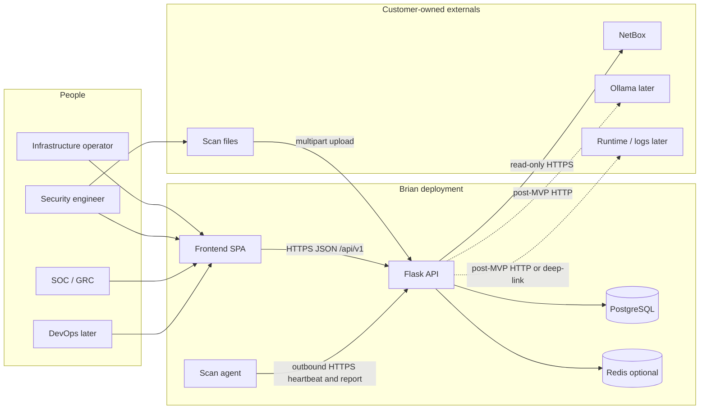
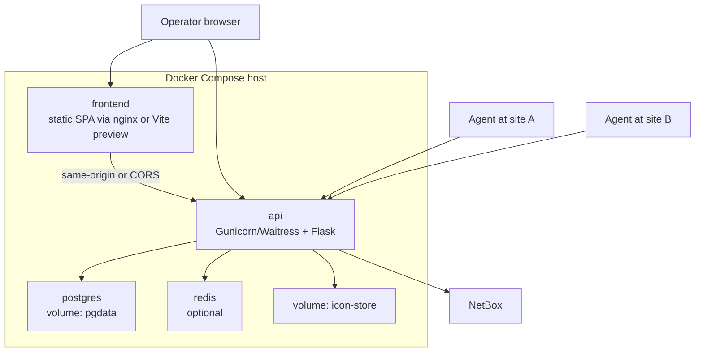
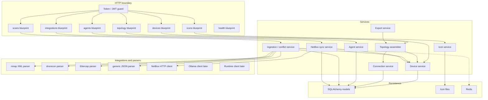
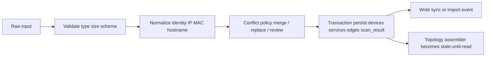
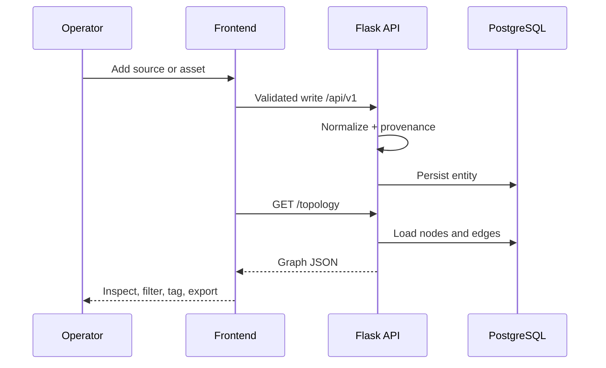
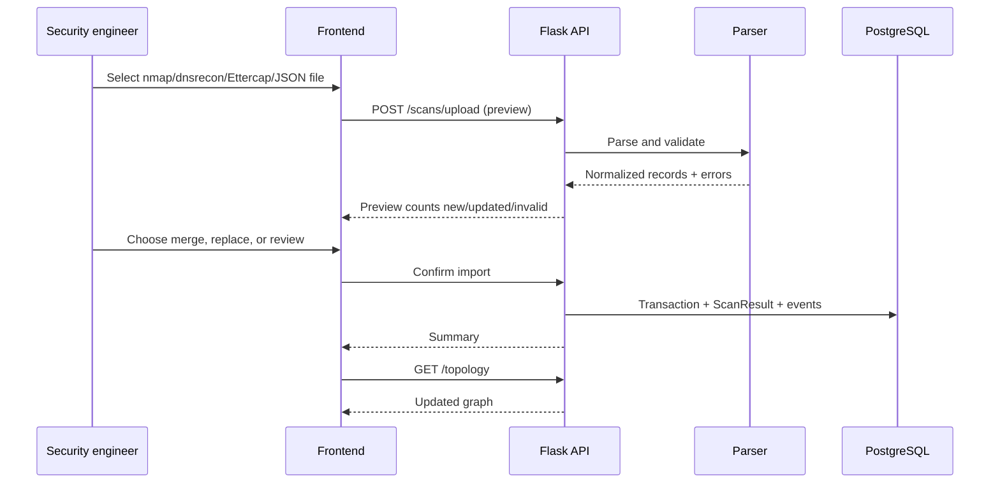
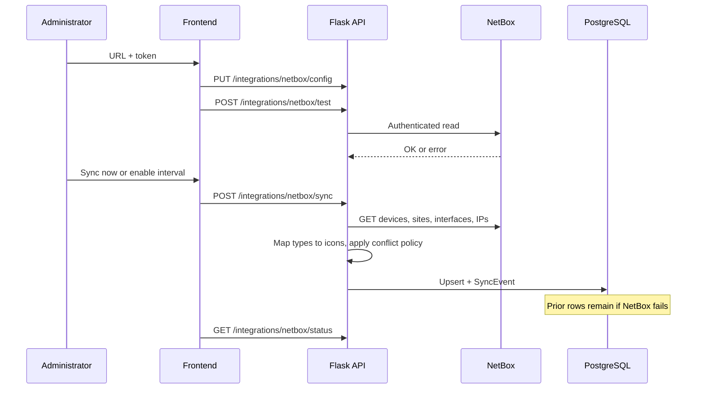
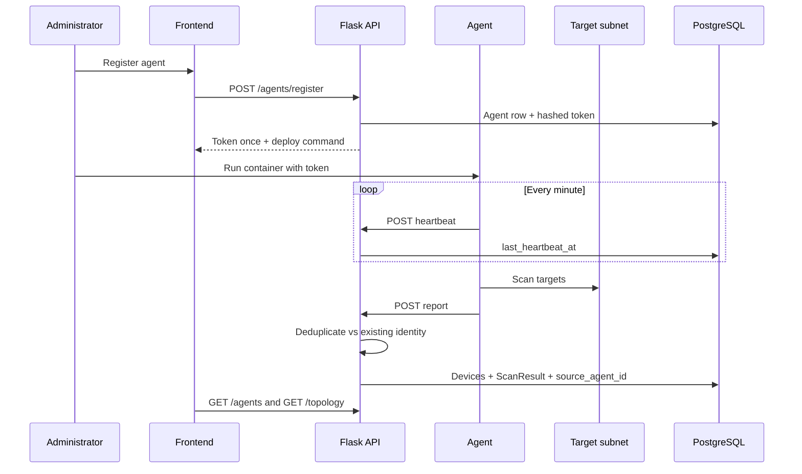
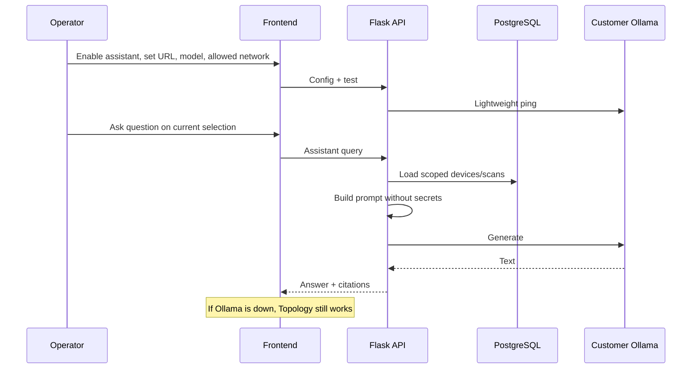

# System Architecture: Brian

**Project:** Brian — Open-Source Network and Infrastructure Topology Platform  
**Document Version:** 1.0  
**Date:** September 25, 2026  
**Status:** Architecture of record for implementation  
**Related:** [PRD](./PRD.md), [SRS](./SRS.md)

This document describes the services Brian **makes**, the systems it **uses**, how they **communicate**, and the **workflows** that move data from observation to topology. The implementation backend is **Flask**, not Node.js or FastAPI.

---

## 1. Purpose and Scope

Brian is a self-hosted operational topology layer. It aggregates infrastructure facts from people, files, NetBox, and outbound scanning agents, then presents a single inspectable graph.

This architecture covers:

- Runtime services in an MVP Docker Compose deployment
- Internal API module boundaries
- External systems Brian calls or receives data from
- Trust boundaries, authentication, and failure isolation
- End-to-end workflows for the core loop and documented post-MVP overlays

This architecture does **not** turn Brian into a packet capture product, vulnerability scanner, hosted LLM, CI/CD engine, Kubernetes control plane, or NetBox replacement.

### 1.1 Implementation status

Product requirements, SRS, and this architecture are the current source of truth. Application trees `frontend/` and `backend/` are the intended homes for the React and Flask code. Until those services exist in-repo, this document is the blueprint implementers must follow rather than a description of a running production cluster.

### 1.2 Architectural goals

| ID | Goal | How it is achieved |
|---|---|---|
| G1 | Unified discovery | One persistence model with `scan_source`, timestamps, and agent provenance |
| G2 | Topology first | Graph assembled in a topology service; UI is a client of `/topology` |
| G3 | Safe integrations | NetBox is read-only; agent tokens are scoped; secrets never return in ordinary responses |
| G4 | Failure isolation | Missing NetBox, agent, Redis, or later Ollama must not hide already stored topology |
| G5 | Extensible ingestion | Parsers and integration clients sit behind a validation/normalization boundary |
| G6 | Boring operations | Compose deployment, health checks, env-based config, versioned `/api/v1` |

---

## 2. Made vs Used

Brian is a **composed** system. Some processes are first-party. Others are customer-owned and only connected.

### 2.1 Services Brian makes (first-party)

| Service | What it is | Why it exists |
|---|---|---|
| **Web frontend** | React 18 + TypeScript + Vite SPA | Operator UI: topology, devices, integrations, settings |
| **API** | Flask application factory + blueprints | Versioned REST business logic, validation, authn of tokens |
| **Scan agent** | Lightweight Linux container or systemd service | Discover remote subnets Brian cannot reach inbound |
| **Database schema & migrations** | PostgreSQL via SQLAlchemy + Flask-Migrate | Durable devices, edges, scans, agents, icons, events |
| **Icon object store** | Filesystem volume (MVP) | Custom SVG/PNG assets with path confinement |
| **OpenAPI contract** | Generated/maintained API description | Frontend, agents, and tests share one HTTP contract |

### 2.2 Services Brian uses (customer-owned or infrastructure)

| System | Relationship | Direction | MVP? |
|---|---|---|---|
| **PostgreSQL 13+** | System of record | API → DB (SQL) | Required |
| **Redis** | Cache, rate limits, optional job/status keys | API → Redis | Optional |
| **Reverse proxy / TLS terminator** | Browser auth, HTTPS | Browser → proxy → frontend/API | Production required; local optional |
| **NetBox** | Read-only IPAM/DCIM source | API → NetBox HTTPS | Integration phase |
| **Operator workstation tools** | nmap, dnsrecon, Ettercap, CSV/JSON | File upload into API | Integration phase |
| **Ollama** | Customer-owned LLM runtime | API → Ollama HTTP | Post-MVP |
| **Container runtime or log system** | Docker/containerd/K8s API or log deep-link | API → runtime/logs (optional) | Post-MVP |
| **Browser** | Rendering, local theme preference | Human → frontend | Required |

Brian does **not** make NetBox, Ollama, PostgreSQL, Redis, nmap, or a container orchestrator. It talks to them across documented adapters.

---

## 3. System Context

Operators and agents never write PostgreSQL directly. All mutation goes through the API so validation, provenance, and conflict policy stay consistent.



### 3.1 Trust boundaries

| Boundary | Inside | Outside | Rule |
|---|---|---|---|
| B1 Browser | SPA, localStorage theme | User OS | No secrets in localStorage except non-privileged UI prefs. Tokens only if the deployment model requires it and HTTPS is on. |
| B2 Edge | Reverse proxy | Internet / LAN | TLS, optional interactive auth, request size limits |
| B3 API | Flask process | Proxy, agents, NetBox | Bearer tokens; agent tokens cannot call admin config |
| B4 Data | PostgreSQL, icon volume | API only | No public DB port in Compose except developer bind |
| B5 Agent | Agent host / target subnet | Central Brian | Outbound-only to Brian; Brian never opens inbound to the agent |
| B6 NetBox | NetBox API | Brian | Read-only token; sync failures must not delete prior data |
| B7 Model | Customer Ollama | Brian | Explicit URL; no secrets in prompts; optional |
| B8 Runtime | Docker/K8s/log system | Brian | Explicit enablement; console is audited if offered |

---

## 4. Container View (Runtime)

MVP Compose runs on **one server**. Agents usually run **somewhere else**.



### 4.1 Container responsibilities

#### Frontend (`frontend`)

- **Made with:** React function components, TypeScript domain types, Vite, Lucide icons, Cytoscape.js or equivalent graph library, CSS variables for the Brian palette.
- **Serves:** Dashboard, Topology, Devices, Integrations, Settings, Help.
- **Talks to:** `/api/v1` through a single typed client. Mock data, if present during early UI work, stays in a named data module and must not be mixed into the API client.
- **Does not:** Parse nmap XML, store NetBox tokens, or compute agent heartbeat status.

#### API (`backend`)

- **Made with:** Flask application factory, Blueprints, Flask-SQLAlchemy, Marshmallow (or equivalent schema layer), Flask-Migrate, Flask-JWT-Extended or opaque API tokens as documented, OpenAPI.
- **Serves:** JSON under `/api/v1`, file upload endpoints, health, OpenAPI JSON/UI for implementers.
- **Talks to:** PostgreSQL, optional Redis, NetBox, icon volume, later Ollama/runtime.
- **Does not:** Render the graph canvas or scrape networks itself (agents and uploaded files do that).

#### PostgreSQL

- **Used as:** System of record for devices, connections, locations, agents (hashed tokens), icons metadata, scan results, sync/audit events, saved views when implemented, persisted node positions.
- **Not used as:** A cache for NetBox live reads. After sync, Brian answers from its own tables.

#### Redis (optional)

- **Used as:** Rate-limit counters, short-lived import job status, cache of expensive topology stats.
- **Failure mode:** If Redis is down, reads of persisted topology still succeed. Rate limiting may degrade to in-process limits.

#### Scan agent (`agent`, separate image)

- **Made with:** Small Python or shell-wrapped scanner container, outbound HTTPS client, nmap/ARP/DNS capabilities as available.
- **Talks to:** Only Brian `POST /agents/:id/heartbeat` and `POST /agents/:id/report`, plus pulling config if exposed on the agent-scoped API.
- **Talks to target network:** Local scans only. No inbound port required from Brian.

---

## 5. API Component View

Route handlers stay thin. Validation happens at the HTTP boundary. Business rules live in services. I/O to NetBox or files lives in clients and parsers.



### 5.1 Suggested backend layout

```
backend/
├── app/
│   ├── __init__.py              # create_app()
│   ├── config.py
│   ├── extensions.py            # db, migrate, ma, jwt
│   ├── errors.py                # consistent JSON errors
│   ├── api/
│   │   └── v1/
│   │       ├── __init__.py      # register blueprints
│   │       ├── devices.py
│   │       ├── topology.py
│   │       ├── scans.py
│   │       ├── agents.py
│   │       ├── integrations.py
│   │       ├── icons.py
│   │       └── health.py
│   ├── models/
│   ├── schemas/                 # Marshmallow
│   ├── services/
│   ├── parsers/
│   └── integrations/
│       └── netbox.py
├── migrations/
├── tests/
├── openapi.yaml                 # or generated
└── requirements.txt
```

### 5.2 Suggested frontend layout

```
frontend/src/
├── app/                         # shell, router, theme
├── pages/                       # Dashboard, Topology, Devices, Integrations, Settings
├── components/                  # canvas, panels, forms
├── services/api/                # typed client only
├── data/mock/                   # temporary mock records, clearly named
├── types/                       # Device, Connection, Agent, ...
└── styles/                      # CSS variables, themes
```

---

## 6. Communication

All first-party service communication for MVP is **synchronous HTTPS/JSON**, except file uploads (`multipart/form-data`) and binary exports (`image/svg+xml`, `image/png`, `text/csv`).

Long work (NetBox sync, large parse) should return **202 + job status** or otherwise avoid blocking unrelated requests (SRS NFR-ARCH-005). Until a queue exists, a thread/process worker plus a `jobs` table or Redis key is acceptable. A message broker is optional, not required for MVP.

### 6.1 Protocol matrix

| From | To | Protocol | Auth | Payload | Failure behavior |
|---|---|---|---|---|---|
| Browser | Frontend static | HTTPS | Proxy session if deployed | HTML/JS/CSS | App does not load |
| Browser | API | HTTPS REST | `Authorization: Bearer` | JSON | Typed error; UI keeps last good view where possible |
| Frontend | API | Same-origin or CORS | Bearer | JSON / multipart | Empty/error states on that view only |
| Agent | API | Outbound HTTPS | Agent-scoped bearer | Heartbeat JSON; report JSON | Agent retries; API keeps last heartbeat |
| API | PostgreSQL | TCP SQL | DB role from env | ORM | 5xx; no partial silent commit on import |
| API | Redis | TCP Redis | Optional password | Keys | Degrade; topology still served from DB |
| API | NetBox | HTTPS REST | NetBox token (secret) | Read devices/sites/interfaces/IPs | Sync error log; **do not** wipe Brian data |
| Operator | API | HTTPS upload | Bearer | nmap XML, dnsrecon, pcap/logs, JSON, CSV | Validation errors; no corrupt unrelated rows |
| API | Icon volume | Local FS | OS user of API | SVG/PNG | Reject unsafe SVG/path |
| API | Ollama (later) | HTTP | None or customer token | Prompt JSON, no secrets | Hide assistant; MVP features remain |
| API | Runtime (later) | HTTP or deep-link URL | Customer creds | Workload list / log tail | Inspector shows unavailable; hosts remain |

### 6.2 API conventions

- Base path: `/api/v1`
- JSON errors: `{ "error": { "code": "...", "message": "...", "details": [] } }` plus documented HTTP status
- List routes: pagination, filter, sort
- Time: ISO-8601 UTC
- IDs: UUID
- Agent routes `/agents/:id/heartbeat` and `/agents/:id/report` reject non-agent tokens
- Integration config routes reject agent tokens

### 6.3 Endpoint map (MVP)

Grouped as the frontend and agents actually use them.

**Operator / UI**

| Method | Path | Typical caller |
|---|---|---|
| GET/POST/PUT/DELETE | `/devices`, `/devices/:id` | Devices view, details panel |
| POST | `/devices/bulk/import` | CSV import |
| POST | `/devices/:id/rescan` | Context menu |
| GET | `/topology`, `/topology/stats`, `/topology/export` | Canvas, dashboard, export |
| POST/GET | `/scans/upload`, `/scans`, `/scans/:id` | Scan upload panel |
| POST/GET/PUT/DELETE | `/agents`, `/agents/:id` | Agent management (not heartbeat) |
| POST/GET/PUT | `/integrations/netbox/*` | Integrations settings |
| GET/POST/DELETE | `/icons`, `/icons/upload`, `/icons/:id` | Icon library |

**Agent-only**

| Method | Path | Purpose |
|---|---|---|
| POST | `/agents/:id/heartbeat` | Liveness |
| POST | `/agents/:id/report` | Normalized findings |

**Platform**

| Method | Path | Purpose |
|---|---|---|
| GET | `/health` or `/api/v1/health` | Compose healthcheck |
| GET | OpenAPI | Contract for clients and tests |

### 6.4 Agent heartbeat contract (logical)

Agents POST a compact payload on an interval (suggested 60s). Brian classifies:

| Last heartbeat | Status |
|---|---|
| ≤ 5 minutes | `online` |
| > 5 minutes and ≤ 1 hour | `degraded` |
| > 1 hour or never | `offline` |

Brian does not wait for inbound access to the agent. On-demand scan is a flag or command the agent picks up on the next heartbeat (pull), or a documented alternative that still requires no inbound agent port.

---

## 7. Data Architecture

### 7.1 Canonical entities

| Entity | Identity | Notes |
|---|---|---|
| Device | UUID; unique normalized `ip_address` | Provenance: `scan_source`, `source_agent_id`, `last_scanned_at` |
| Connection | UUID; source/target device, optional interfaces | Types: direct, inferred, DNS, Layer 2, service |
| Location | UUID; unique name | Maps to NetBox site when synced |
| Agent | UUID; hashed token | Status derived from heartbeats |
| Icon | UUID; path on volume | Built-in vs custom |
| ScanResult | UUID | Raw or normalized payload retained |
| TopologyPosition | device/edge id + coordinates | Manual layout wins after explicit arrange |
| SyncEvent / AuditEvent | UUID | NetBox sync, imports, config changes |

Post-MVP child entity **Workload** belongs to a Device; it is not a parallel inventory.

### 7.2 Source of truth rules

1. **Brian tables** are the operational topology the UI reads.
2. **NetBox** is authoritative for imported DCIM/IPAM fields **at sync time**, subject to the configured conflict policy (manual merge, timestamp, source preference).
3. **Scan files and agents** are authoritative for reachability, services, and last-seen, subject to merge/replace/review.
4. **Manual edits** are first-class and must not be silently overwritten unless the conflict policy says so.
5. **Ollama** is never a source of truth.

### 7.3 Ingestion pipeline

Every import, whether file, NetBox, or agent report, uses the same pipeline:



If validation fails, nothing in the batch that is specified as atomic is committed. Unrelated existing records remain.

---

## 8. Security Architecture

| Concern | Mechanism |
|---|---|
| API authentication | Bearer token on protected routes. Interactive user login is **not** an MVP product feature; production uses a reverse proxy or gateway in front of Brian. Local development may use JWT issued by Flask-JWT-Extended for API tests and the SPA. |
| Agent authorization | Per-agent scoped token: heartbeat, report, and permitted reads only |
| Admin authorization | Distinct token or role; agent tokens cannot change NetBox config |
| Secrets | Env/config; hashed agent tokens; NetBox token never echoed; redacted logs |
| Uploads | Type, size, structure; SVG sanitization; no path traversal |
| Rate limits | Auth, upload, heartbeat, report |
| Production transport | HTTPS at proxy or app |
| Post-MVP LLM | Customer Ollama only by default; strip secrets from context |
| Post-MVP console | Explicit flag, customer credentials, audit event, no stored root shells |

---

## 9. Deployment Architecture

### 9.1 Local / MVP Compose (target)

| Compose service | Image role | Persistent volumes | Health |
|---|---|---|---|
| `frontend` | nginx + built SPA or Vite | none required | HTTP 200 on `/` |
| `api` | Flask WSGI | `icon-store` | `/health` talks to DB |
| `postgres` | Official PostgreSQL 13+ | `pgdata` | `pg_isready` |
| `redis` | Official Redis | optional AOF | `PING` |

Configuration is environment variables: database URL, Redis URL, secret key, upload limits, icon path, CORS origin, NetBox settings stored encrypted or in a secrets table—not in git.

### 9.2 Remote agent

Deployed with `BRIAN_SERVER`, `AGENT_TOKEN`, `AGENT_NAME`, `SCAN_TARGETS`. Example is Docker; systemd is supported. The agent host needs egress to Brian and L2/L3 access to scan targets.

### 9.3 Production sketch

```
Internet/LAN
    │
    ▼
Reverse proxy (TLS, optional SSO)
    ├─ /           → frontend
    └─ /api/v1     → api
         │
         ├─ PostgreSQL (private network)
         ├─ Redis (private network)
         └─ egress to NetBox / later Ollama
```

Kubernetes, HA, and LDAP/SSO are **out of MVP**. The API should remain stateless aside from DB/Redis so those can be added later.

---

## 10. Workflows

The following sequences are the architecture’s behavioral contract. They match PRD section 7 and SRS section 5.

### 10.1 Core loop



### 10.2 Manual device lifecycle

1. Operator opens Devices and chooses Add Device.
2. Frontend validates required fields and IP format, then `POST /devices`.
3. API re-validates, enforces unique IP, writes `scan_source=manual`.
4. Device appears in list and in `GET /topology`.
5. Edit, tag, rescan, export, or delete go through the same API; delete asks for confirmation and respects referential rules for connections.

### 10.3 Scan file import



Undo within 10 minutes is a **Should** (SRS FR-SCAN-015): implement as a compensating transaction or snapshot of affected IDs, not as a second database.

### 10.4 NetBox read-only sync



Disconnect stops future sync and **keeps** imported data unless the operator explicitly deletes it.

### 10.5 Distributed agent discovery



On-demand rescan: UI `POST /devices/:id/rescan` or agent trigger records a request the agent observes; Brian still does not open a port to the agent.

### 10.6 Topology presentation

1. UI requests `GET /topology` with active filters.
2. Topology service joins devices, connections, positions, icons, and derived status.
3. Canvas applies layout only where the user has not pinned positions.
4. Selection loads `GET /devices/:id` into the details panel (progressive disclosure).
5. Export uses `GET /topology/export` with the same filter scope.

The graph library runs **in the browser**. The API returns data, not a bitmap, except when an export job renders SVG/PNG on the server.

### 10.7 Continuous monitoring (stale hosts)

1. Agent scheduled scan no longer observes a previously seen IP.
2. Report includes absence or a full set that omits the host, per documented agent contract.
3. Device service applies stale/offline policy; it does not delete without operator action.
4. UI shows offline/unavailable with non-color indicators.
5. Operator decommissions or restores.

### 10.8 Post-MVP: Ollama assistant



### 10.9 Post-MVP: DevOps workloads

1. A runtime adapter or agent plugin lists containers for a host Device.
2. API stores Workload children (name, state, last seen, source).
3. Host inspector lists workloads; canvas stays host-centric.
4. Logs: bounded tail **or** deep-link to the customer log system.
5. Optional console: explicit enablement, customer credentials, audit row.

---

## 11. Cross-Cutting Runtime Concerns

### 11.1 Observability

The API logs: request errors, sync events, scan imports, agent heartbeats (without tokens), background job failures. Fields: timestamp, severity, operation, result, correlation id. Metrics (should): latency, device count, scan count, sync failures, agent status.

### 11.2 Error taxonomy (frontend)

The SPA distinguishes transient, validation, permission, and unavailable-integration errors so a NetBox outage does not look like a broken canvas.

### 11.3 Performance envelopes

| Check | Target |
|---|---|
| First page load | < 2 s typical local/LAN |
| 500-node render after data | < 1 s |
| Ordinary API p95 | < 100 ms excluding sync/parse/export |
| Agent /24 scan | < 5 minutes typical (agent-side) |

Level-of-detail, pagination, clustering, and async jobs are the scale path toward 10,000 devices.

### 11.4 Extensibility hooks

| Hook | Add a new… | Without rewriting… |
|---|---|---|
| Parser module | Scan file type | Topology canvas |
| Integration client | IPAM/DCIM | Device model |
| Agent capability | Local probe | API public contract (additive fields) |
| Icon pack | SVG set | Graph physics |
| Ollama client | Assistant | Persistence |
| Workload adapter | Runtime | Host identity |

---

## 12. Decisions Locked by This Document

| Decision | Choice | Rejected |
|---|---|---|
| API language | Python Flask factory + blueprints | Node/Express, FastAPI, Django as MVP |
| UI | React + TypeScript + Vite | Multi-page server render |
| Graph | Client-side library (Cytoscape.js or equal) | Server-side only images |
| Database | PostgreSQL 13+ | SQLite as production store |
| Cache | Redis optional | Required Redis for MVP reads |
| NetBox | Read-only sync | Two-way write |
| Agents | Outbound-only to Brian | Brian-initiated inbound to agent |
| Auth MVP | Bearer tokens + reverse proxy for humans | Full in-app SSO/RBAC |
| LLM | Customer Ollama, later | Bundled or vendor default model |
| Workloads | Child of host device, later | Separate DevOps product graph |

---

## 13. Traceability

| Architecture topic | PRD | SRS |
|---|---|---|
| Components and Compose | §10 | §3, NFR-DEP |
| REST map | §9 | IR-API |
| Data model | §8 | §7 |
| NetBox | §4.3, §6.4 | FR-NBX, IR-NBX |
| Agents | §4.4, §6.6 | FR-AGENT, IR-AGENT |
| Scans | §4.3, §6.5 | FR-SCAN |
| Workflows | §7 | §5 |
| Security | §14 constraints | §8 |
| Ollama / DevOps | §17 | §14 |
| Out of scope | §13 | §13.3 |

---

## 14. Document History

| Version | Date | Change |
|---|---|---|
| 1.0 | 2026-09-25 | Initial architecture of record: made vs used services, communication, workflows, Flask/React/PostgreSQL stack. |
