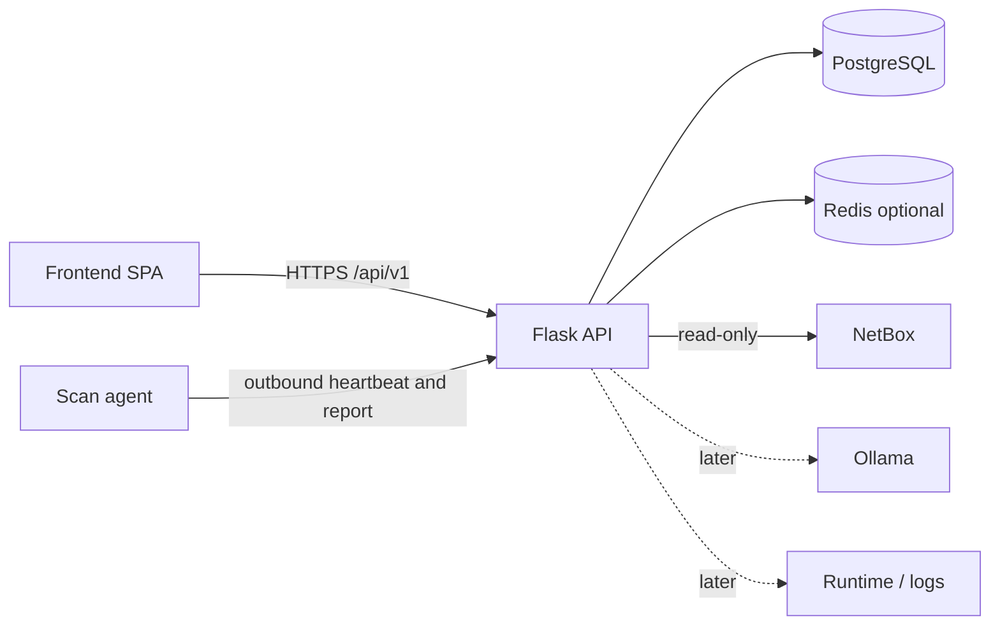

# System Architecture

Canonical document: [[../.humans/Architecture|Architecture]].

Brian is a central Flask API plus a React SPA. PostgreSQL is the system of record. Redis is optional. Scan agents call Brian outbound-only. NetBox is a read-only source. Ollama and container runtimes are later, customer-owned overlays.

## Made vs used

**Brian makes:** frontend, API, scan agent, schema/migrations, icon volume, OpenAPI contract.

**Brian uses:** PostgreSQL, optional Redis, reverse proxy/TLS, NetBox, operator scan files, later Ollama, later runtime/log systems.

## Context

## Core workflow

1. Operator, file, NetBox, or agent supplies an observation.
2. API validates and normalizes it.
3. Persistence stores the entity with source and timestamps.
4. Topology service returns the graph.
5. UI inspects, filters, tags, or exports.
6. Failed NetBox/agent/Ollama must not hide already stored topology.

## Do not implement yet

Assistant and workload overlays wait for the core loop. See [[07 - Feature Plans]] and [[09 - Decisions]].
